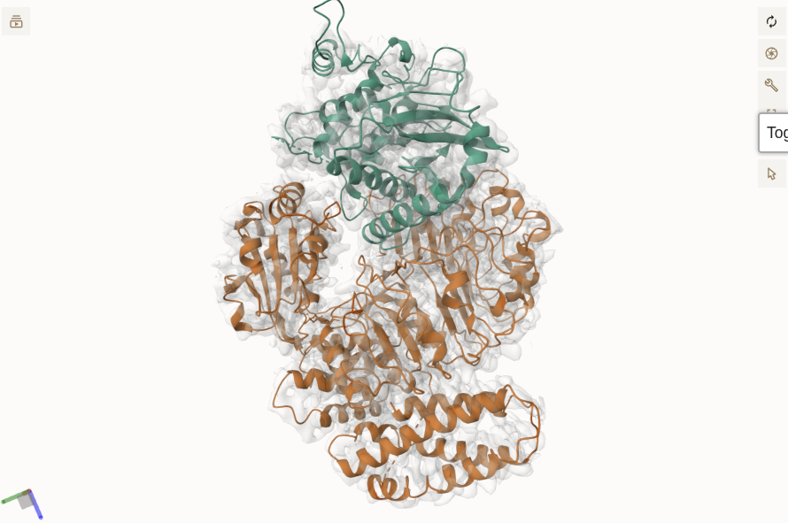

# Tutorial: rediscover 6J5W in EMD-0683

[6J5W](https://www.rcsb.org/structure/6J5W) is an Arabidopsis thaliana ZAR1–RKS1
complex fitted to the 3.7 Å map [EMD-0683](https://www.ebi.ac.uk/emdb/EMD-0683).
We treat ZAR1 (chain A, UniProt Q38834) as the unknown protein and RKS1 (chain
B) as its known partner. We remove the RKS1 density from the map, fit candidate
structures into the remaining density with PowerFit, and refine the fits against
RKS1 with HADDOCK3.

Protein-detective is intended for low-resolution maps (about 5–8 Å). EMD-0683
is a high-resolution map (<4.5 Å), used here because its deposited model lets us
check the results.



EMD-0683 with the fitted 6J5W model: ZAR1 (orange, bottom) is the protein to
rediscover, RKS1 (green, top) is the known partner.

<!--
Screenshot from the
[EMDB 3D viewer](https://www.ebi.ac.uk/emdb/EMD-0683?tab=3dview)
with reduced volume opacity.
-->

## 1. Requirements

- [protein-detective](index.md) on your `PATH` (Python 3.13 or later)
- `curl` and `gzip`
- [ChimeraX](https://www.rbvi.ucsf.edu/chimerax/), here run as Flatpak; use
  `chimerax` for a native install
- a GPU for PowerFit

All files go into the session directory `tutorial-6j5w/`.

## 2. Search for candidates

Search reviewed Arabidopsis proteins annotated with ADP binding
([GO:0043531](https://www.ebi.ac.uk/QuickGO/term/GO:0043531)), with canonical
sequences of 800–900 residues. AlphaFold candidates are skipped to keep the
tutorial short.

```shell
protein-detective candidates search tutorial-6j5w \
    --taxon-id 3702 \
    --reviewed \
    --molecular-function-go GO:0043531 \
    --min-sequence-length 800 \
    --max-sequence-length 900 \
    --limit-uniprot 100 \
    --alphafold.limit 0 \
    --pdbe.limit 50 \
    --pdbe.min-residues 750 \
    --pdbe.max-residues 900 \
    --pdbe.top-resolution-per-uniprot-accession 2

cat tutorial-6j5w/pdbe.csv
```

Check that 6J5W was found:

<details markdown="1">
<summary>Python script to check the search candidates</summary>

```shell
python3 - <<'PY'
import csv
from pathlib import Path

session = Path("tutorial-6j5w")
with (session / "pdbe.csv").open() as stream:
    ids = {row["pdb_id"].upper() for row in csv.DictReader(stream)}
assert "6J5W" in ids, ids
assert len(ids) > 1, ids
print("Search candidates:", sorted(ids))
PY
```

</details>

## 3. Retrieve and filter the structures

```shell
protein-detective candidates retrieve tutorial-6j5w

protein-detective candidates filter tutorial-6j5w \
    --min-residues 750 \
    --max-residues 900 \
    --min-geometry-quality 50 \
    --top-uniprot-cluster 2 \
    --scheduler-address sequential

cat tutorial-6j5w/combined_stats.csv
ls tutorial-6j5w/combined_output
```

Two structures of ZAR1 pass: 6J5T (`6j5t_updated_C2A.cif.gz`) and 6J5W
(`6j5w_updated_A2A.cif.gz`). The other candidates have too few residues.

## 4. Download the experimental map and reference complex

```shell
curl -fL --retry 3 \
    https://ftp.ebi.ac.uk/pub/databases/emdb/structures/EMD-0683/map/emd_0683.map.gz \
    -o tutorial-6j5w/emd_0683.map.gz

gzip -dk tutorial-6j5w/emd_0683.map.gz

curl -fL --retry 3 \
    https://www.ebi.ac.uk/pdbe/entry-files/download/6j5w_updated.cif.gz \
    -o tutorial-6j5w/6j5w_updated.cif.gz
```

## 5. Remove the known RKS1 density from the map

Simulate a 3.7 Å map of RKS1 and zero the experimental map inside it, as in
[the EM preparation notebook](em_prepare.ipynb).

```shell
gzip -dk tutorial-6j5w/6j5w_updated.cif.gz

cat > tutorial-6j5w/mask-rks1.cxc <<'EOF'
open emd_0683.map
open 6j5w_updated.cif
delete #2/A
molmap #2 3.7
volume mask #1 surfaces #3 invertMask true
save emd_0683-without-rks1.mrc models #4
exit
EOF

(cd tutorial-6j5w &&
    flatpak run edu.ucsf.rbvi.ChimeraX --nogui --exit --script mask-rks1.cxc)
```

Check that the density at RKS1 is gone and at ZAR1 is kept:

<details markdown="1">
<summary>Python script to check the masked map</summary>

```shell
python3 - <<'PY'
from pathlib import Path

import gemmi
import numpy as np

session = Path("tutorial-6j5w")
structure = gemmi.read_structure(str(session / "6j5w_updated.cif"))
grid = gemmi.read_ccp4_map(str(session / "emd_0683-without-rks1.mrc"), setup=True).grid
for chain in structure[0]:
    values = [grid.interpolate_value(atom.pos) for residue in chain for atom in residue if atom.name == "CA"]
    print(chain.name, "mean density at CA atoms:", round(float(np.mean(values)), 4))
PY
```

</details>

## 6. Fit both candidates into the masked EMD-0683 map

Fitting both candidates takes about 40 seconds on an NVIDIA GeForce RTX 3050.

```shell
protein-detective powerfit run \
    tutorial-6j5w/emd_0683-without-rks1.mrc 3.7 \
    tutorial-6j5w \
    --angle 10 \
    --scheduler-address sequential \
    --powerfit-run-id emd0683

protein-detective powerfit list-runs tutorial-6j5w \
    --output tutorial-6j5w/powerfit-runs.csv

protein-detective powerfit report tutorial-6j5w \
    --powerfit-run-id emd0683 \
    --top 1 \
    --output tutorial-6j5w/powerfit-report.csv

cat tutorial-6j5w/powerfit-report.csv
```

The report has the best solution per candidate; higher `cc` is better. 6J5W
scores 0.31 in its deposited pose, 6J5T only 0.066.

Write the fitted models:

```shell
protein-detective powerfit fit-models tutorial-6j5w \
    --powerfit-run-id emd0683 \
    --top 1 \
    --output tutorial-6j5w/fitted-models.csv
```

## 7. Refine against the known RKS1 partner

Use 6J5W without chain A as the fixed RKS1 partner. The small sampling settings
keep the run to a few minutes.

```shell
protein-detective refine run \
    tutorial-6j5w \
    tutorial-6j5w/6j5w_updated.cif.gz \
    --remove-fixed-chains A \
    --powerfit-run-id emd0683 \
    --refine-run-id emd0683-small \
    --rigidbody-sampling 10 \
    --top-clusters 1 \
    --top-models 1 \
    --water-refinement-sampling-factor 1 \
    --water-refinement-solvent none \
    --ncores "$(nproc)" \
    --scheduler-address sequential

protein-detective refine list-runs tutorial-6j5w

protein-detective refine report tutorial-6j5w \
    --refine-run-id emd0683-small \
    --top 1 \
    --output tutorial-6j5w/refined.csv

cat tutorial-6j5w/refined.csv
```

Lower HADDOCK scores are better. Before refinement 6J5W scores −258.0 and 6J5T
−30.4; after refinement 6J5W scores −85.5 and 6J5T −96.5. Ten rigid-body samples
are too few to keep the native pose, so increase `--rigidbody-sampling` for real
use.

## 8. Visualize fitted models

<!--
TODO: add a `protein-detective visualize` CLI command that shows the fitted
(PowerFit) and refined (HADDOCK3) structures together with the density map,
so this chapter can use a single command instead of the Python script below.
-->

Write an HTML viewer of the fitted models and the masked map:

<details markdown="1">
<summary>Python script to write <code>fitted-models.html</code></summary>

```shell
python3 - <<'PY'
from pathlib import Path

from protein_detective.visualization import (
    load_fitted_models,
    show_fitted_models_and_density,
)

root = Path("tutorial-6j5w")
models = load_fitted_models(
    fitted_models_csv=root / "fitted-models.csv",
    report_csv=root / "powerfit-report.csv",
    runs_csv=root / "powerfit-runs.csv",
)
html = show_fitted_models_and_density(models, renderer="html")
(root / "fitted-models.html").write_text(html)
PY
```

</details>

Open `tutorial-6j5w/fitted-models.html` in a browser. See
[the visualization notebook](visualization.ipynb) for more examples.

## 9. Build the metadata database and check the results

```shell
protein-detective meta tutorial-6j5w
```

<details markdown="1">
<summary>Python script to check the pipeline outputs</summary>

```shell
python3 - <<'PY'
from pathlib import Path

import duckdb
import numpy as np
import pandas as pd

root = Path("tutorial-6j5w")
report = pd.read_csv(root / "powerfit-report.csv")
assert "6J5W" in set(report["structure_id"].str.upper())
assert len(report) == 2, report
assert np.isfinite(report["cc"]).all()
fitted = pd.read_csv(root / "fitted-models.csv")
assert len(fitted) == 2
assert all(Path(path).is_file() for path in fitted["fitted_model_file"])
refined = pd.read_csv(root / "refined.csv")
assert not refined.empty
assert np.isfinite(refined[["model_score", "unrefined_score"]]).all().all()
assert all(Path(path).is_file() for path in refined["model_path"])
with duckdb.connect(str(root / "meta.duckdb"), read_only=True) as db:
    print(db.sql("SHOW TABLES"))
    print(db.sql("""
        SELECT structure_id, max(cc) AS best_cc
        FROM solutions
        GROUP BY structure_id
        ORDER BY best_cc DESC
    """))
print("Pipeline outputs verified.")
PY
```

</details>

See [the metadata notebook](meta.ipynb) for queries on `meta.duckdb`.
